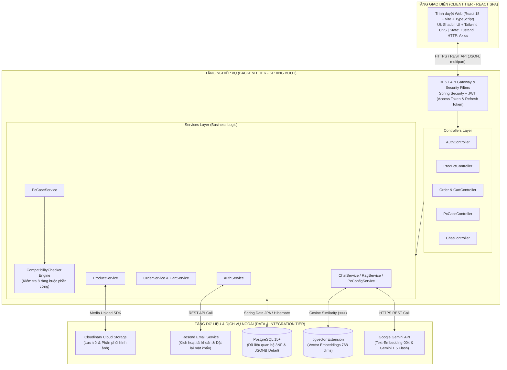
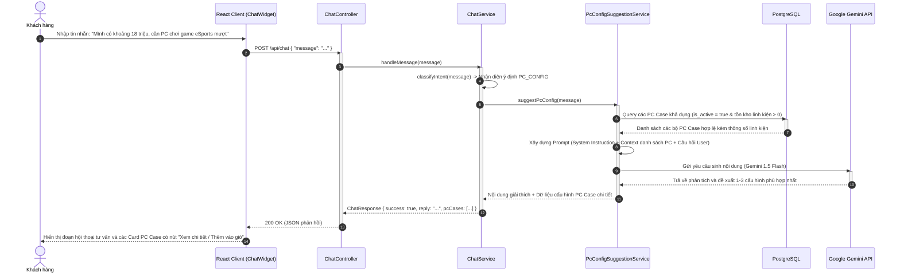
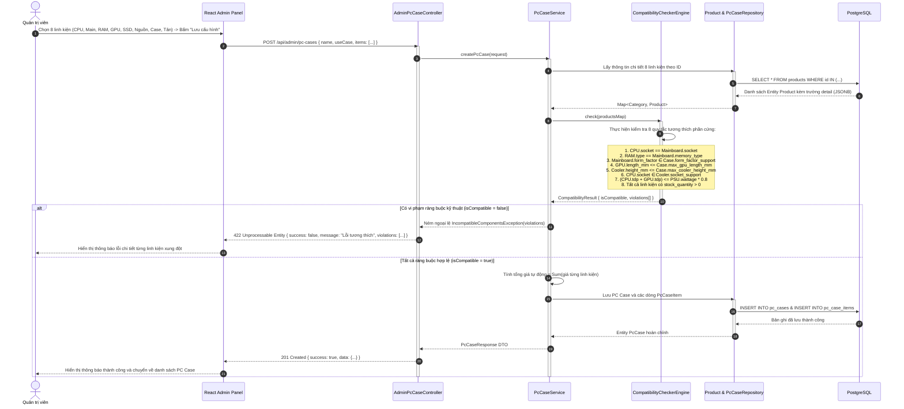
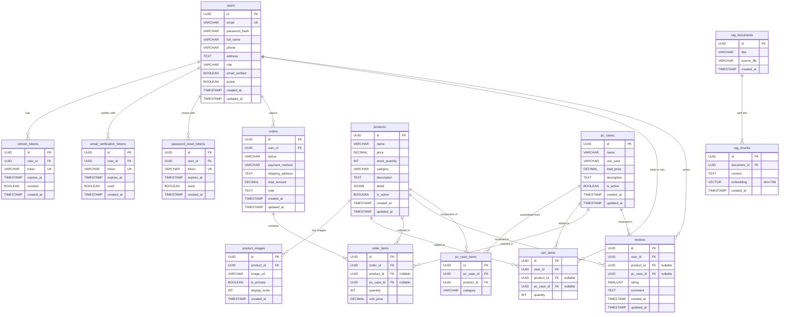

# THIẾT KẾ VÀ CÀI ĐẶT GIẢI PHÁP

---

## Tổng quan hệ thống

Hệ thống **"Ứng dụng web bán linh kiện máy tính tích hợp AI hỗ trợ gợi ý cấu hình"** (*Computer Components Shop with AI Integration*) được nghiên cứu và xây dựng nhằm giải quyết triệt để hai rào cản lớn nhất của thị trường thương mại điện tử linh kiện phần cứng hiện nay: **tính phức tạp về tương thích vật lý/điện năng giữa các linh kiện** và **khó khăn của người dùng phổ thông trong việc định hình cấu hình PC tối ưu theo ngân sách và nhu cầu thông qua ngôn ngữ tự nhiên**.

Về mặt tổng thể, hệ thống là một nền tảng thương mại điện tử chuyên ngành tích hợp giải pháp Trí tuệ nhân tạo (AI) toàn diện, bao gồm ba phân hệ chức năng cốt lõi:

1. **Phân hệ Thương mại điện tử dành cho Khách hàng (Client E-commerce Portal):**
   - Cung cấp trải nghiệm mua sắm trực tuyến chuyên biệt: duyệt danh mục sản phẩm, tìm kiếm đa tiêu chí, bộ lọc linh kiện nâng cao theo thông số kỹ thuật đặc thù (Socket, chuẩn RAM, kích thước form factor, công suất TDP...).
   - Quản lý giỏ hàng kép linh hoạt, hỗ trợ lưu trữ và xử lý đồng thời cả linh kiện máy tính bán lẻ và các bộ cấu hình PC hoàn chỉnh (PC Case).
   - Quy trình đặt hàng trực quan với hình thức thanh toán khi nhận hàng (Cash On Delivery - COD), theo dõi vòng đời đơn hàng theo thời gian thực và cho phép khách hàng đánh giá, chấm điểm sao (1–5 sao) cho các sản phẩm/bộ máy đã mua.
2. **Phân hệ Trợ lý ảo Trí tuệ nhân tạo (AI Chatbot Service):**
   - **Hỏi đáp chính sách cửa hàng (RAG Engine):** Ứng dụng kiến trúc Retrieval-Augmented Generation (RAG) kết hợp giữa mô hình nhúng vector ngữ nghĩa (Gemini Embedding API), tiện ích mở rộng `pgvector` trên cơ sở dữ liệu PostgreSQL và mô hình ngôn ngữ lớn (LLM) để tra cứu, trích xuất thông tin chính xác từ kho tài liệu chính sách (bảo hành, đổi trả, vận chuyển) và sinh phản hồi tự nhiên, chuẩn xác, loại trừ hoàn toàn hiện tượng ảo giác.
   - **Tư vấn cấu hình máy tính thông minh (PC Suggestion Engine):** Tiếp nhận mô tả nhu cầu sử dụng (gaming, lập trình, đồ họa 3D, văn phòng) và khoảng ngân sách của người dùng dưới dạng ngôn ngữ tự nhiên; tự động phân tích và đề xuất 1–3 bộ PC Case phù hợp nhất được tuyển chọn từ các cấu hình có sẵn trong hệ thống (đã được kiểm định tương thích phần cứng và đảm bảo còn hàng tồn kho).
3. **Phân hệ Quản trị hệ thống (Admin Management Panel):**
   - Quản lý danh mục linh kiện máy tính với cấu trúc thông số kỹ thuật động lưu dưới dạng bán cấu trúc `JSONB`, đồng bộ lưu trữ và tối ưu hóa hình ảnh tải lên dịch vụ đám mây Cloudinary.
   - Quản lý vòng đời đơn hàng từ lúc tiếp nhận đến khi giao hàng thành công hoặc hủy đơn.
   - **Bộ công cụ khởi tạo PC Case:** Cho phép quản trị viên lựa chọn các linh kiện thành phần theo từng slot và tự động kích hoạt **Bộ máy kiểm tra tương thích phần cứng (Hardware Compatibility Checker Engine)** để thẩm định 8 quy tắc kỹ thuật nghiêm ngặt trước khi lưu trữ vào hệ thống.
   - Quản lý tri thức RAG (tải lên tài liệu chính sách, bóc tách phân đoạn văn bản, tính toán vector embedding) và theo dõi bảng điều khiển thống kê chỉ số kinh doanh (doanh thu, đơn hàng, khách hàng, sản phẩm bán chạy).

Hệ thống phục vụ ba nhóm tác nhân (Actors) chính với các phạm vi quyền hạn được phân định rõ ràng:
- **Khách vãng lai (Guest):** Xem danh mục sản phẩm, xem chi tiết thông số kỹ thuật và đánh giá sản phẩm; xem danh sách cấu hình PC Case; tương tác trực tiếp với Trợ lý AI (hỏi đáp chính sách và nhận tư vấn cấu hình); thực hiện đăng ký tài khoản mới.
- **Khách hàng thành viên (User):** Thừa hưởng toàn bộ quyền của Guest; thực hiện đăng nhập bảo mật (JWT); quản lý thông tin cá nhân; thêm linh kiện và PC Case vào giỏ hàng; tiến hành đặt hàng COD; theo dõi lịch sử và trạng thái đơn hàng; gửi đánh giá và nhận xét cho các sản phẩm/PC Case đã mua.
- **Quản trị viên (Admin):** Thừa hưởng quyền của User; toàn quyền quản lý sản phẩm linh kiện; quản lý và cập nhật trạng thái đơn hàng; khởi tạo và chỉnh sửa cấu hình PC Case kèm kiểm định tương thích tự động; nạp và quản lý tài liệu RAG; truy cập bảng điều khiển thống kê số liệu tổng thể.

---

## Kiến trúc hệ thống

### Thiết kế kiến trúc

Hệ thống được thiết kế và xây dựng theo mô hình **Kiến trúc Phân tầng Client - Server (3-Tier Layered Architecture)** hiện đại, tách biệt hoàn toàn giữa tầng giao diện người dùng (Presentation Tier) và tầng xử lý nghiệp vụ (Business Logic Tier), giao tiếp với nhau thông qua giao thức chuẩn **RESTful API** với định dạng trao đổi dữ liệu JSON (`application/json`):



#### Phân tích chi tiết các tầng trong kiến trúc:

1. **Tầng Trình diễn (Client Tier - React Single Page Application):**
   - Được xây dựng dưới dạng ứng dụng đơn trang (SPA) bằng **React 18**, **TypeScript** và công cụ đóng gói siêu tốc **Vite**.
   - Giao diện được thiết kế dựa trên bộ thành phần **Shadcn UI** (xây dựng trên nền tảng Radix UI nguyên tử) kết hợp cùng framework CSS tiện ích **Tailwind CSS**, mang lại giao diện tinh gọn, chuẩn thẩm mỹ hiện đại và đáp ứng linh hoạt trên nhiều kích thước màn hình (Responsive Web Design).
   - Quản lý trạng thái ứng dụng phía Client bằng **Zustand** — giải pháp quản lý trạng thái tập trung gọn nhẹ, hiệu năng cao, giảm thiểu việc re-render không cần thiết so với Redux truyền thống.
   - Tầng Client giao tiếp hoàn toàn bất đồng bộ với Backend thông qua thư viện **Axios**, tích hợp cơ chế tự động gắn Access Token vào Header và Interceptor xử lý làm mới phiên đăng nhập (Silent Refresh Token).

2. **Tầng Nghiệp vụ (Backend Tier - Spring Boot Application):**
   - Đóng vai trò là trung tâm điều phối toàn bộ tài nguyên và quy tắc kinh doanh của hệ thống, xây dựng trên nền tảng **Java 17/21** và framework **Spring Boot 3.x**.
   - Tầng bảo mật sử dụng **Spring Security 6** kết hợp cơ chế xác thực không trạng thái (Stateless Authentication) thông qua **JSON Web Token (JWT)**.
   - Triển khai thuật toán kiểm định tương thích phần cứng độc lập (`CompatibilityCheckerEngine`), bảo đảm tính toàn vẹn kỹ thuật của mọi bộ PC Case trước khi ghi nhận vào cơ sở dữ liệu.
   - Điều phối luồng xử lý AI thông minh: phân loại ý định người dùng (User Intent Classification), tích hợp RAG pipeline và định hình ngữ cảnh (Prompt Engineering) để tương tác với mô hình ngôn ngữ lớn.

3. **Tầng Dữ liệu và Tích hợp Dịch vụ ngoài (Data & External Integration Tier):**
   - **PostgreSQL 15+:** Hệ quản trị cơ sở dữ liệu quan hệ mạnh mẽ, đảm bảo tính toàn vẹn giao dịch (ACID) cho người dùng, đơn hàng và danh mục sản phẩm; đồng thời hỗ trợ kiểu dữ liệu bán cấu trúc `JSONB` với khả năng lập chỉ mục GIN để quản lý thông số kỹ thuật linh kiện động.
   - **Tiện ích mở rộng `pgvector`:** Tích hợp trực tiếp khả năng lưu trữ vector embedding đa chiều và thực hiện truy vấn khoảng cách tương đồng Cosine Similarity ngay trong lòng PostgreSQL.
   - **Google Gemini API:** Cung cấp dịch vụ mô hình AI tiên tiến, bao gồm mô hình tạo vector nhúng ngữ nghĩa (`text-embedding-004`) và mô hình ngôn ngữ lớn tạo sinh (`gemini-1.5-flash`).
   - **Cloudinary:** Dịch vụ lưu trữ đám mây chuyên dụng quản lý toàn bộ tệp tin hình ảnh sản phẩm, cung cấp CDN phân phối nội dung với tốc độ tối ưu.
   - **Resend:** Nền tảng gửi email giao dịch hiện đại, đảm bảo tỷ lệ gửi thành công cao cho các tác vụ gửi liên kết xác thực kích hoạt tài khoản và khôi phục mật khẩu.

#### Các quyết định kiến trúc cốt lõi và phân tích đánh đổi (Design Trade-offs):

- **Lựa chọn Kiến trúc Phân tầng Client - Server (SPA + REST API) thay vì Kiến trúc Nguyên khối Server-Side Rendering (Monolithic SSR - JSP/Thymeleaf):**
  - *Ưu điểm:* Phân tách rõ ràng trách nhiệm giữa Frontend và Backend, cho phép hai nhóm lập trình viên phát triển song song độc lập. Giao diện SPA mang lại trải nghiệm mượt mà, không giật lag hay tải lại toàn trang khi người dùng tương tác, đặc biệt là khung hội thoại Chatbot AI đòi hỏi độ phản hồi tức thì.
  - *Đánh đổi:* Cần xử lý cẩn trọng vấn đề Cross-Origin Resource Sharing (CORS), cơ chế bảo mật phiên làm việc qua Token và cấu hình định tuyến phía Client (Client-side Routing).
- **Lựa chọn PostgreSQL kết hợp `pgvector` thay vì Cơ sở dữ liệu Vector chuyên biệt (như Pinecone, Milvus, Qdrant):**
  - *Ưu điểm:* Toàn bộ dữ liệu nghiệp vụ quan hệ (sản phẩm, đơn hàng, tài khoản) và dữ liệu vector embedding (đoạn tài liệu RAG) cùng nằm trong một hệ quản trị duy nhất. Điều này giúp tối giản hóa hạ tầng triển khai, loại bỏ sự phức tạp của việc đồng bộ dữ liệu giữa hai cơ sở dữ liệu khác nhau, giảm chi phí vận hành và cực kỳ phù hợp với quy mô một đồ án tốt nghiệp/niên luận ngành.
  - *Đánh đổi:* Hiệu năng tìm kiếm vector trên tập dữ liệu hàng chục triệu bản ghi có thể không tối ưu bằng các vector DB chuyên dụng; tuy nhiên với tập dữ liệu chính sách cửa hàng (vài trăm đến vài nghìn vector), `pgvector` với chỉ mục `ivfflat` đáp ứng tốc độ phản hồi tính bằng mili-giây với độ ổn định tuyệt đối.
- **Chiến lược "Kiểm định trước - Gợi ý sau" (Anti-hallucination PC Builder Architecture):**
  - Thay vì cho phép LLM tự do ghép nối linh kiện theo xác suất từ ngữ (vốn có nguy cơ rất cao sinh ra cấu hình sai socket, thiếu nguồn, hoặc gợi ý sản phẩm không có trong kho), hệ thống quy định quản trị viên là người tạo ra các cấu hình PC Case mẫu dựa trên công cụ kiểm tra tương thích tự động 8 bước. Khi người dùng yêu cầu, AI chỉ đóng vai trò phân tích ngữ nghĩa, lọc và gợi ý bộ PC tối ưu nhất từ tập hợp cấu hình hợp lệ có sẵn. Quyết định này loại bỏ 100% rủi ro ảo giác phần cứng, bảo vệ uy tín bán hàng của doanh nghiệp.

---

### Mô tả sự phân rã

Để đảm bảo nguyên tắc trách nhiệm duy nhất (Single Responsibility Principle - SRP) và tính dễ bảo trì, mở rộng của mã nguồn, hệ thống được phân rã thành các gói và module độc lập ở cả hai phía Client và Backend.

#### 1. Phân rã kiến trúc phía Client (Frontend Modules)

Ứng dụng React được tổ chức theo cấu trúc module hướng tính năng (Feature-based Architecture):

| Module | Đường dẫn / Thành phần | Chức năng và Trách nhiệm |
| :--- | :--- | :--- |
| **Auth Module** | `src/features/auth/` | Xử lý đăng ký, đăng nhập, xác thực email, quên/đặt lại mật khẩu; quản lý Access Token trong bộ nhớ và bảo vệ các tuyến đường (`ProtectedRoute`, `AdminRoute`). |
| **Product Module** | `src/features/products/` | Hiển thị danh sách sản phẩm; thanh tìm kiếm và bộ lọc đa tiêu chí (danh mục, khoảng giá, thuộc tính `detail`); hiển thị trang chi tiết linh kiện kèm thông số kỹ thuật động và khối đánh giá sản phẩm. |
| **PC Case Module** | `src/features/pc-cases/` | Hiển thị danh mục các bộ máy tính hoàn chỉnh được lắp ráp sẵn; xem chi tiết các linh kiện cấu thành trong từng case; thêm nguyên bộ PC Case vào giỏ hàng. |
| **Cart & Checkout** | `src/features/cart/` & `src/features/checkout/` | Quản lý giỏ hàng phía Client qua Zustand (đồng bộ với API Backend khi đã đăng nhập); giao diện điều chỉnh số lượng; form nhập địa chỉ giao hàng và xác nhận đặt đơn hàng COD. |
| **Order History** | `src/features/orders/` | Hiển thị danh sách lịch sử đơn hàng của người dùng, chi tiết từng đơn hàng kèm trạng thái tiến trình; hỗ trợ hủy đơn hàng khi đang ở trạng thái `PENDING`. |
| **Chatbot Widget** | `src/features/chat/` | Cửa sổ trò chuyện AI nổi (Floating Chat Widget); hiển thị tin nhắn người dùng và phản hồi Markdown của AI; kết xuất các thẻ cấu hình PC tương tác có thể click xem chi tiết hoặc thêm nhanh vào giỏ. |
| **Admin Panel** | `src/features/admin/` | Phân hệ quản trị tách biệt: Bảng điều khiển thống kê (Dashboard Charts); Quản lý kho linh kiện (CRUD, nhập JSON thông số, upload ảnh Cloudinary); Quản lý đơn hàng (chuyển đổi trạng thái đơn); Trình tạo PC Case (chọn 8 linh kiện, nút thẩm định tương thích); Quản lý tài liệu RAG (upload tệp chính sách, bóc tách chunks). |

#### 2. Phân rã kiến trúc phía Backend (Spring Boot Layers & Services)

Phía máy chủ Backend được tổ chức theo cấu trúc phân tầng tiêu chuẩn trong phát triển phần mềm doanh nghiệp: `Controller` $\rightarrow$ `Service` $\rightarrow$ `Repository` $\rightarrow$ `Entity`, kèm theo các gói bổ trợ chuyên trách (`config`, `security`, `dto`, `exception`):

| Tầng / Gói | Lớp tiêu biểu | Trách nhiệm chính |
| :--- | :--- | :--- |
| **Security Layer** | `JwtAuthenticationFilter`, `JwtTokenProvider`, `SecurityConfig` | Bắt chặn mọi Request, phân tích JWT Bearer Token, kiểm tra tính hợp lệ và thiết lập ngữ cảnh bảo mật (`SecurityContextHolder`); phân quyền theo `Role` (`USER`, `ADMIN`). |
| **Auth Service** | `AuthController`, `AuthService` | Mã hóa mật khẩu bằng thuật toán BCrypt; cấp phát cặp Access Token và Refresh Token; xử lý thu hồi token trong bảng `refresh_tokens`; quản lý token gửi qua email Resend. |
| **Product Service** | `ProductController`, `ProductService`, `ProductRepository` | Thực hiện các thao tác CRUD linh kiện; truy vấn lọc động dựa trên danh mục (`category`), giá bán và các thuộc tính lưu trong trường `detail` (JSONB). |
| **Compatibility Engine** | `CompatibilityCheckerService`, `CompatibilityResult` | **Bộ máy quy tắc phần cứng:** Thực hiện thẩm định tự động 8 quy tắc kỹ thuật tương thích và kiểm tra tính sẵn sàng tồn kho của linh kiện khi Admin tạo/sửa PC Case. |
| **PC Case Service** | `PcCaseController`, `AdminPcCaseController`, `PcCaseService` | Quản lý danh mục cấu hình máy tính hoàn chỉnh; phối hợp với `CompatibilityCheckerService` trước khi lưu vào CSDL; tính toán tổng giá tự động từ các linh kiện con. |
| **Cart & Order Service**| `CartService`, `OrderService`, `OrderRepository` | Quản lý giỏ hàng linh kiện và PC Case; thực hiện giao dịch tạo đơn hàng COD, trừ số lượng tồn kho của các linh kiện thành phần và điều phối trạng thái đơn. |
| **RAG Service** | `RagService`, `RagDocumentRepository`, `RagChunkRepository` | Tiếp nhận tệp tài liệu chính sách (PDF/DOCX/TXT), bóc tách văn bản thành các đoạn nhỏ (chunking), gọi Gemini Embedding API tạo vector 768 chiều và lưu vào PostgreSQL (`pgvector`); thực thi truy vấn tìm kiếm tương đồng Cosine. |
| **PC Suggestion Service**| `PcConfigSuggestionService` | Truy vấn các PC Case đang kích hoạt (`is_active = true`) và toàn bộ linh kiện thành phần còn hàng trong kho; cấu trúc hóa dữ liệu làm Context gửi tới Gemini API để đề xuất cấu hình phù hợp với câu hỏi của khách hàng. |
| **Chat Orchestrator** | `ChatController`, `ChatService` | Tiếp nhận tin nhắn từ người dùng, thực hiện phân loại ý định (Intent Classification: hỏi chính sách RAG hay nhờ tư vấn PC), điều phối gọi đến `RagService` hoặc `PcConfigSuggestionService` và trả về kết quả JSON đồng nhất. |
| **Statistics Service** | `StatisticsController`, `StatisticsService` | Truy vấn và tổng hợp các chỉ số kinh doanh quan trọng: tổng doanh thu, số lượng đơn hàng theo trạng thái, số lượng khách hàng mới và danh sách các linh kiện/PC Case bán chạy nhất. |

#### 3. Sơ đồ tương tác tuần tự giữa các thành phần tiêu biểu

##### Luồng 1: Người dùng tương tác với Chatbot AI để nhận tư vấn cấu hình PC



##### Luồng 2: Quản trị viên khởi tạo PC Case và kích hoạt kiểm tra tương thích phần cứng



---

## Thiết kế dữ liệu

### Mô hình dữ liệu

Để đáp ứng đặc thù vừa mang tính giao dịch chặt chẽ của thương mại điện tử, vừa đảm bảo tính linh hoạt cho thông số kỹ thuật phần cứng đa dạng và hỗ trợ tìm kiếm ngữ nghĩa cho AI, hệ thống áp dụng **Chiến lược tổ chức dữ liệu lai (Hybrid Data Storage Strategy)** trên nền tảng **PostgreSQL 15+**:

1. **Dữ liệu quan hệ chuẩn hóa (Relational Data):**
   - Áp dụng các nguyên tắc chuẩn hóa dữ liệu (Chuẩn 3NF) cho các thực thể mang tính giao dịch cốt lõi: tài khoản người dùng (`users`), đơn hàng (`orders`), chi tiết đơn hàng (`order_items`, `pc_case_order_items`), giỏ hàng (`cart_items`, `pc_case_cart_items`), đánh giá (`reviews`) và cấu hình PC (`pc_cases`, `pc_case_items`).
   - Đảm bảo tính toàn vẹn tham chiếu thông qua khóa chính (Primary Key - UUID v4), khóa ngoại (Foreign Key) và các ràng buộc loại trừ (`CHECK`), ràng buộc duy nhất (`UNIQUE`).
2. **Dữ liệu bán cấu trúc (Semi-structured Data - JSONB):**
   - Trong bảng sản phẩm (`products`), thuộc tính `detail` được lưu trữ dưới kiểu dữ liệu nhị phân `JSONB`.
   - Mỗi chủng loại linh kiện máy tính (CPU, Card màn hình, Nguồn, Bo mạch chủ...) có những thuộc tính kỹ thuật hoàn toàn khác nhau. Sử dụng `JSONB` cho phép lưu trữ cấu trúc thuộc tính đa dạng này trên cùng một bảng sản phẩm mà không cần tạo hàng chục bảng con hoặc sử dụng mô hình EAV (Entity-Attribute-Value) cồng kềnh, đồng thời cho phép tạo chỉ mục GIN (Generalized Inverted Index) để truy vấn tốc độ cao.
3. **Dữ liệu Vector nhúng ngữ nghĩa (Vector Embeddings - pgvector):**
   - Bảng `rag_chunks` sử dụng kiểu dữ liệu mở rộng `VECTOR(768)` để lưu trữ vector biểu diễn ngữ nghĩa của các đoạn văn bản chính sách do Gemini Embedding API sinh ra.
   - Xây dựng chỉ mục không gian vector `ivfflat` kết hợp toán tử khoảng cách cosine `<=>` (`vector_cosine_ops`) nhằm tăng tốc tối đa các truy vấn tìm kiếm đoạn văn bản tương đồng phục vụ Chatbot RAG.
4. **Dữ liệu xác thực và bảo mật phiên (Security & Tokens):**
   - Quản lý các mã phiên và mã xác thực thông qua các bảng riêng biệt: `refresh_tokens` (hỗ trợ thu hồi token chủ động), `email_verification_tokens` (xác thực email khi đăng ký) và `password_reset_tokens` (khôi phục mật khẩu).

#### Sơ đồ thực thể - mối quan hệ (ERD - Entity-Relationship Diagram)



#### Quy chuẩn cấu trúc trường `detail` (JSONB) theo từng danh mục linh kiện:

Để thuật toán `CompatibilityCheckerEngine` có thể tự động bóc tách và kiểm tra tính tương thích, trường `detail` trong bảng `products` được định dạng chuẩn hóa theo từng danh mục phần cứng như sau:

```jsonc
// 1. CPU (Bộ vi xử lý)
{
  "socket": "LGA1700",          // Loại chân cắm (Socket tương thích)
  "cores": 14,                  // Tổng số nhân xử lý
  "threads": 20,                // Tổng số luồng xử lý
  "base_clock_ghz": 3.5,        // Xung nhịp cơ bản (GHz)
  "boost_clock_ghz": 5.1,       // Xung nhịp tối đa (GHz)
  "tdp_w": 125,                 // Công suất thiết kế nhiệt tiêu thụ (W)
  "memory_type": "DDR4/DDR5",   // Chuẩn RAM CPU hỗ trợ giao tiếp
  "integrated_gpu": true        // Tích hợp nhân đồ họa tích hợp sẵn hay không
}

// 2. MAINBOARD (Bo mạch chủ)
{
  "socket": "LGA1700",          // Socket tương thích với CPU
  "form_factor": "ATX",         // Kích thước chuẩn bo mạch (ATX, mATX, ITX)
  "chipset": "B760",            // Dòng chipset điều khiển
  "memory_type": "DDR5",        // Chuẩn RAM bo mạch chủ chấp nhận (DDR4 hoặc DDR5)
  "memory_slots": 4,            // Số khe cắm RAM vật lý
  "max_memory_gb": 128,         // Dung lượng RAM tối đa hỗ trợ (GB)
  "m2_slots": 3,                // Số khe cắm ổ cứng SSD M.2 NVMe
  "pcie_version": 5.0           // Phiên bản chuẩn giao tiếp PCI Express
}

// 3. RAM (Bộ nhớ trong)
{
  "type": "DDR5",               // Chuẩn bộ nhớ RAM (DDR4 / DDR5)
  "speed_mhz": 6000,            // Tần số xung nhịp bus bộ nhớ (MHz)
  "capacity_gb": 16,            // Dung lượng trên mỗi thanh (GB)
  "sticks": 2,                  // Số lượng thanh RAM trong bộ kit
  "total_gb": 32                // Tổng dung lượng bộ kit (GB)
}

// 4. GPU (Card màn hình / đồ họa rời)
{
  "vram_gb": 12,                // Dung lượng bộ nhớ đồ họa VRAM (GB)
  "vram_type": "GDDR6X",        // Chuẩn chip nhớ đồ họa
  "tdp_w": 200,                 // Công suất tiêu thụ điện tối đa của card (W)
  "pcie_slot": "x16",           // Giao tiếp khe cắm PCIe
  "length_mm": 285              // Chiều dài vật lý của card đồ họa (mm)
}

// 5. STORAGE (Ổ đĩa lưu trữ SSD / HDD)
{
  "type": "NVMe SSD",           // Chủng loại ổ (NVMe SSD, SATA SSD, HDD)
  "capacity_gb": 1000,          // Dung lượng lưu trữ (GB)
  "interface": "M.2 PCIe 4.0",  // Giao tiếp kết nối vật lý
  "read_mbps": 5000,            // Tốc độ đọc tuần tự tối đa (MB/s)
  "write_mbps": 4500            // Tốc độ ghi tuần tự tối đa (MB/s)
}

// 6. PSU (Bộ nguồn máy tính)
{
  "wattage_w": 750,             // Công suất định danh tối đa của bộ nguồn (W)
  "efficiency": "80+ Gold",     // Chứng nhận hiệu suất chuyển đổi năng lượng
  "modular": "Full",            // Dạng dây nguồn (Full-Modular, Semi, Non-Modular)
  "form_factor": "ATX"          // Chuẩn kích thước bộ nguồn
}

// 7. CASE (Vỏ máy tính)
{
  "form_factor_support": [      // Các chuẩn kích thước bo mạch chủ vỏ case hỗ trợ
    "ATX",
    "mATX",
    "ITX"
  ],
  "max_gpu_length_mm": 340,     // Chiều dài tối đa cho phép của card đồ họa (mm)
  "max_cooler_height_mm": 165,  // Chiều cao tối đa cho phép của tản nhiệt khí CPU (mm)
  "drive_bays_35": 2,           // Số lượng khay lắp ổ cứng 3.5 inch (HDD)
  "drive_bays_25": 2            // Số lượng khay lắp ổ cứng 2.5 inch (SATA SSD)
}

// 8. CPU_COOLER (Tản nhiệt vi xử lý)
{
  "type": "Air",                // Loại tản nhiệt (Air: tản khí, AIO: tản nhiệt nước)
  "socket_support": [           // Danh sách các socket CPU mà ngàm tản nhiệt hỗ trợ
    "LGA1700",
    "AM5",
    "AM4"
  ],
  "height_mm": 158,             // Chiều cao tản nhiệt tính từ mặt bo mạch chủ (mm)
  "radiator_size_mm": 0,        // Kích thước radiator tản nhiệt nước (nếu là AIO)
  "tdp_support_w": 220          // Khả năng giải nhiệt tối đa hỗ trợ cho CPU (W)
}
```

---

### Từ điển dữ liệu

Dưới đây là từ điển dữ liệu chi tiết của 14 bảng thực thể trong hệ thống, mô tả rõ kiểu dữ liệu, ràng buộc khóa, quy tắc toàn vẹn và ý nghĩa nghiệp vụ:

#### 1. Bảng `users` (Tài khoản người dùng)
Lưu trữ thông tin tài khoản người dùng và quản trị viên của hệ thống.

| Tên thuộc tính | Kiểu dữ liệu | Khóa | Ràng buộc | Diễn giải |
| :--- | :--- | :---: | :--- | :--- |
| `id` | UUID | PK | NOT NULL | Khóa chính, mã định danh duy nhất của người dùng |
| `email` | VARCHAR(255) | UK | NOT NULL, UNIQUE | Địa chỉ email đăng nhập duy nhất trên toàn hệ thống |
| `password_hash` | VARCHAR(255) | | NOT NULL | Mật khẩu tài khoản đã được mã hóa an toàn bằng thuật toán BCrypt |
| `full_name` | VARCHAR(255) | | NULL | Họ và tên đầy đủ của người dùng |
| `phone` | VARCHAR(20) | | NULL | Số điện thoại liên lạc của người dùng |
| `address` | TEXT | | NULL | Địa chỉ nhận hàng mặc định |
| `role` | VARCHAR(20) | | NOT NULL, DEFAULT 'USER' | Vai trò người dùng (`USER` hoặc `ADMIN`) |
| `email_verified`| BOOLEAN | | NOT NULL, DEFAULT FALSE | Trạng thái kích hoạt tài khoản qua email xác thực |
| `active` | BOOLEAN | | NOT NULL, DEFAULT TRUE | Trạng thái hoạt động của tài khoản (khóa/mở khóa) |
| `created_at` | TIMESTAMP | | NOT NULL, DEFAULT NOW() | Thời điểm tài khoản được tạo trên hệ thống |
| `updated_at` | TIMESTAMP | | NOT NULL, DEFAULT NOW() | Thời điểm cập nhật thông tin tài khoản gần nhất |

#### 2. Bảng `products` (Linh kiện máy tính)
Lưu trữ toàn bộ danh mục sản phẩm linh kiện phần cứng máy tính bán lẻ.

| Tên thuộc tính | Kiểu dữ liệu | Khóa | Ràng buộc | Diễn giải |
| :--- | :--- | :---: | :--- | :--- |
| `id` | UUID | PK | NOT NULL | Khóa chính, mã định danh duy nhất của sản phẩm linh kiện |
| `name` | VARCHAR(255) | | NOT NULL | Tên thương mại của linh kiện máy tính |
| `price` | DECIMAL(15, 2) | | NOT NULL, CHECK (price > 0) | Đơn giá bán niêm yết của linh kiện (VNĐ) |
| `stock_quantity`| INT | | NOT NULL, DEFAULT 0, CHECK (>=0) | Số lượng linh kiện tồn kho khả dụng |
| `category` | VARCHAR(20) | | NOT NULL | Phân loại linh kiện: `CPU`, `MAINBOARD`, `RAM`, `GPU`, `STORAGE`, `PSU`, `CASE`, `CPU_COOLER` |
| `description` | TEXT | | NULL | Bài viết mô tả giới thiệu chi tiết sản phẩm |
| `detail` | JSONB | | NOT NULL | Đặc tính kỹ thuật riêng biệt theo từng category phục vụ kiểm tra tương thích |
| `is_active` | BOOLEAN | | NOT NULL, DEFAULT TRUE | Trạng thái hiển thị bán (áp dụng soft delete khi xóa sản phẩm) |
| `created_at` | TIMESTAMP | | NOT NULL, DEFAULT NOW() | Thời điểm thêm sản phẩm vào kho hệ thống |
| `updated_at` | TIMESTAMP | | NOT NULL, DEFAULT NOW() | Thời điểm cập nhật thông tin linh kiện gần nhất |

#### 3. Bảng `product_images` (Hình ảnh sản phẩm)
Lưu trữ danh sách hình ảnh của từng sản phẩm linh kiện tải lên dịch vụ đám mây Cloudinary.

| Tên thuộc tính | Kiểu dữ liệu | Khóa | Ràng buộc | Diễn giải |
| :--- | :--- | :---: | :--- | :--- |
| `id` | UUID | PK | NOT NULL | Khóa chính, định danh duy nhất của hình ảnh |
| `product_id` | UUID | FK | NOT NULL, ON DELETE CASCADE | Tham chiếu tới `products(id)` sở hữu hình ảnh |
| `image_url` | VARCHAR(500) | | NOT NULL | Đường dẫn URL hình ảnh lưu trữ trên Cloudinary CDN |
| `is_primary` | BOOLEAN | | NOT NULL, DEFAULT FALSE | Đánh dấu ảnh đại diện chính hiển thị trên danh sách sản phẩm |
| `display_order` | INT | | NOT NULL, DEFAULT 0 | Thứ tự sắp xếp hiển thị ảnh trong thư viện ảnh sản phẩm |
| `created_at` | TIMESTAMP | | NOT NULL, DEFAULT NOW() | Thời điểm tải hình ảnh lên hệ thống |

*Ràng buộc đặc biệt:* `UNIQUE(product_id, is_primary) WHERE (is_primary = TRUE)` đảm bảo mỗi sản phẩm chỉ có tối đa một hình ảnh đại diện chính.

#### 4. Bảng `orders` (Đơn đặt hàng)
Quản lý thông tin các đơn hàng do khách hàng khởi tạo trên hệ thống.

| Tên thuộc tính | Kiểu dữ liệu | Khóa | Ràng buộc | Diễn giải |
| :--- | :--- | :---: | :--- | :--- |
| `id` | UUID | PK | NOT NULL | Khóa chính, mã định danh duy nhất của đơn đặt hàng |
| `user_id` | UUID | FK | NOT NULL | Tham chiếu tới `users(id)` thực hiện đặt hàng |
| `status` | VARCHAR(20) | | NOT NULL, DEFAULT 'PENDING' | Trạng thái đơn hàng: `PENDING`, `CONFIRMED`, `SHIPPING`, `DELIVERED`, `CANCELLED` |
| `payment_method`| VARCHAR(20) | | NOT NULL, DEFAULT 'COD' | Phương thức thanh toán: `COD` (Thanh toán khi nhận hàng) |
| `shipping_address`| TEXT | | NOT NULL | Địa chỉ chi tiết nhận hàng của khách |
| `total_amount` | DECIMAL(15, 2) | | NOT NULL, CHECK (> 0) | Tổng số tiền thanh toán thực tế của đơn hàng (VNĐ) |
| `note` | TEXT | | NULL | Ghi chú hoặc lời dặn của người mua khi giao hàng |
| `created_at` | TIMESTAMP | | NOT NULL, DEFAULT NOW() | Thời điểm khách hàng chốt đặt đơn hàng |
| `updated_at` | TIMESTAMP | | NOT NULL, DEFAULT NOW() | Thời điểm cập nhật trạng thái đơn hàng gần nhất |

#### 5. Bảng `order_items` (Chi tiết đơn hàng)
Lưu danh sách các mặt hàng nằm trong một đơn hàng. Một dòng mục đơn hàng có thể là một linh kiện lẻ HOẶC một bộ cấu hình PC Case hoàn chỉnh.

| Tên thuộc tính | Kiểu dữ liệu | Khóa | Ràng buộc | Diễn giải |
| :--- | :--- | :---: | :--- | :--- |
| `id` | UUID | PK | NOT NULL | Khóa chính của dòng chi tiết đơn hàng |
| `order_id` | UUID | FK | NOT NULL, ON DELETE CASCADE | Tham chiếu tới `orders(id)` |
| `product_id` | UUID | FK | NULL | Tham chiếu tới `products(id)` (nếu mua linh kiện lẻ) |
| `pc_case_id` | UUID | FK | NULL | Tham chiếu tới `pc_cases(id)` (nếu mua nguyên bộ PC) |
| `quantity` | INT | | NOT NULL, CHECK (quantity > 0) | Số lượng sản phẩm/bộ PC đặt mua |
| `unit_price` | DECIMAL(15, 2) | | NOT NULL, CHECK (unit_price > 0)| Đơn giá tại thời điểm chốt đơn đặt hàng (bảo vệ biến động giá) |

*Ràng buộc đặc biệt:* `CHECK ((product_id IS NOT NULL AND pc_case_id IS NULL) OR (product_id IS NULL AND pc_case_id IS NOT NULL))` đảm bảo mỗi dòng đơn hàng chỉ trỏ về đúng một đối tượng (linh kiện hoặc PC Case).

#### 6. Bảng `cart_items` (Chi tiết giỏ hàng)
Quản lý các mục linh kiện lẻ hoặc bộ PC Case được người dùng thêm vào giỏ hàng.

| Tên thuộc tính | Kiểu dữ liệu | Khóa | Ràng buộc | Diễn giải |
| :--- | :--- | :---: | :--- | :--- |
| `id` | UUID | PK | NOT NULL | Khóa chính của mục giỏ hàng |
| `user_id` | UUID | FK | NOT NULL, ON DELETE CASCADE | Tham chiếu tới `users(id)` sở hữu giỏ hàng |
| `product_id` | UUID | FK | NULL | Tham chiếu tới `products(id)` nếu thêm linh kiện lẻ |
| `pc_case_id` | UUID | FK | NULL | Tham chiếu tới `pc_cases(id)` nếu thêm bộ PC Case |
| `quantity` | INT | | NOT NULL, DEFAULT 1, CHECK (> 0) | Số lượng mục tương ứng trong giỏ hàng |

*Ràng buộc đặc biệt:*
- `CHECK ((product_id IS NOT NULL AND pc_case_id IS NULL) OR (product_id IS NULL AND pc_case_id IS NOT NULL))`
- `UNIQUE(user_id, product_id)` và `UNIQUE(user_id, pc_case_id)` đảm bảo mỗi tài khoản chỉ có 1 dòng duy nhất cho mỗi món hàng trong giỏ.

#### 7. Bảng `reviews` (Đánh giá & Nhận xét)
Lưu nhận xét và số sao đánh giá của khách hàng đã mua đối với linh kiện lẻ hoặc bộ PC Case.

| Tên thuộc tính | Kiểu dữ liệu | Khóa | Ràng buộc | Diễn giải |
| :--- | :--- | :---: | :--- | :--- |
| `id` | UUID | PK | NOT NULL | Khóa chính của bản ghi đánh giá |
| `user_id` | UUID | FK | NOT NULL | Tham chiếu tới `users(id)` viết đánh giá |
| `product_id` | UUID | FK | NULL | Tham chiếu tới `products(id)` nếu đánh giá linh kiện lẻ |
| `pc_case_id` | UUID | FK | NULL | Tham chiếu tới `pc_cases(id)` nếu đánh giá bộ máy PC |
| `rating` | SMALLINT | | NOT NULL, CHECK (1 <= rating <= 5) | Điểm số đánh giá chất lượng (từ 1 đến 5 sao) |
| `comment` | TEXT | | NULL | Nội dung bình luận, phản hồi chi tiết về sản phẩm |
| `created_at` | TIMESTAMP | | NOT NULL, DEFAULT NOW() | Thời điểm gửi đánh giá |
| `updated_at` | TIMESTAMP | | NOT NULL, DEFAULT NOW() | Thời điểm chỉnh sửa đánh giá gần nhất |

*Ràng buộc đặc biệt:* `CHECK ((product_id IS NOT NULL AND pc_case_id IS NULL) OR (product_id IS NULL AND pc_case_id IS NOT NULL))` cùng với `UNIQUE(user_id, product_id)` và `UNIQUE(user_id, pc_case_id)` đảm bảo mỗi khách hàng chỉ được đánh giá 1 lần cho mỗi mặt hàng.

#### 8. Bảng `pc_cases` (Cấu hình PC mẫu)
Quản lý các bộ máy tính hoàn chỉnh được thiết lập sẵn, đã vượt qua khâu kiểm tra tương thích kỹ thuật, phục vụ việc mua nguyên bộ hoặc gợi ý qua AI.

| Tên thuộc tính | Kiểu dữ liệu | Khóa | Ràng buộc | Diễn giải |
| :--- | :--- | :---: | :--- | :--- |
| `id` | UUID | PK | NOT NULL | Khóa chính, mã định danh của cấu hình máy tính |
| `name` | VARCHAR(255) | | NOT NULL | Tên gợi nhớ của bộ PC (Ví dụ: "PC Gaming Esports Pro 2026") |
| `use_case` | VARCHAR(100) | | NOT NULL | Nhu cầu mục đích sử dụng (`gaming`, `study`, `office`, `rendering`) |
| `total_price` | DECIMAL(15, 2) | | NOT NULL, CHECK (>= 0) | Tổng giá trị của bộ PC Case (tính tự động từ tổng giá 8 linh kiện) |
| `description` | TEXT | | NULL | Đoạn văn mô tả đặc điểm nổi bật và hiệu năng của bộ máy |
| `is_active` | BOOLEAN | | NOT NULL, DEFAULT TRUE | Trạng thái hiển thị và kinh doanh của bộ PC Case |
| `created_at` | TIMESTAMP | | NOT NULL, DEFAULT NOW() | Thời điểm bộ máy được thiết lập trên hệ thống |
| `updated_at` | TIMESTAMP | | NOT NULL, DEFAULT NOW() | Thời điểm cập nhật cấu hình PC gần nhất |

#### 9. Bảng `pc_case_items` (Linh kiện cấu thành PC Case)
Lưu danh sách các linh kiện phần cứng cụ thể cấu thành nên một bộ máy PC Case.

| Tên thuộc tính | Kiểu dữ liệu | Khóa | Ràng buộc | Diễn giải |
| :--- | :--- | :---: | :--- | :--- |
| `id` | UUID | PK | NOT NULL | Khóa chính của dòng liên kết thành phần PC |
| `pc_case_id` | UUID | FK | NOT NULL, ON DELETE CASCADE | Tham chiếu tới `pc_cases(id)` sở hữu linh kiện |
| `product_id` | UUID | FK | NOT NULL | Tham chiếu tới `products(id)` làm linh kiện thành phần |
| `category` | VARCHAR(20) | | NOT NULL | Khe cắm linh kiện: `CPU`, `MAINBOARD`, `RAM`, `GPU`, `STORAGE`, `PSU`, `CASE`, `CPU_COOLER` |

*Ràng buộc đặc biệt:* `UNIQUE(pc_case_id, category)` đảm bảo mỗi vị trí khe cắm linh kiện trong một PC Case chỉ được chọn chính xác 1 linh kiện tương ứng.

#### 10. Bảng `rag_documents` (Tài liệu tri thức RAG)
Lưu thông tin các tệp tài liệu chính sách của cửa hàng (bảo hành, đổi trả, vận chuyển) do Quản trị viên tải lên.

| Tên thuộc tính | Kiểu dữ liệu | Khóa | Ràng buộc | Diễn giải |
| :--- | :--- | :---: | :--- | :--- |
| `id` | UUID | PK | NOT NULL | Khóa chính, mã định danh duy nhất của tài liệu |
| `title` | VARCHAR(255) | | NOT NULL | Tiêu đề hoặc tên phân loại tài liệu chính sách |
| `source_file` | VARCHAR(255) | | NULL | Tên tệp gốc được tải lên hệ thống (PDF, DOCX, TXT) |
| `created_at` | TIMESTAMP | | NOT NULL, DEFAULT NOW() | Thời điểm tải tài liệu lên hệ thống |

#### 11. Bảng `rag_chunks` (Đoạn văn bản và Vector Embedding)
Lưu các đoạn văn bản được chia nhỏ từ tài liệu RAG kèm vector nhúng ngữ nghĩa tương ứng phục vụ tìm kiếm tương đồng.

| Tên thuộc tính | Kiểu dữ liệu | Khóa | Ràng buộc | Diễn giải |
| :--- | :--- | :---: | :--- | :--- |
| `id` | UUID | PK | NOT NULL | Khóa chính, mã định danh đoạn văn bản |
| `document_id` | UUID | FK | NOT NULL, ON DELETE CASCADE | Tham chiếu tới `rag_documents(id)` gốc |
| `content` | TEXT | | NOT NULL | Nội dung văn bản thô của đoạn ngữ cảnh đã chia nhỏ |
| `embedding` | VECTOR(768) | | NOT NULL | Vector nhúng ngữ nghĩa 768 chiều sinh từ Gemini Embedding API |
| `created_at` | TIMESTAMP | | NOT NULL, DEFAULT NOW() | Thời điểm tính toán và lưu trữ vector |

*Chỉ mục tối ưu:* Chỉ mục vector `ivfflat` với toán tử `vector_cosine_ops` được đánh trên cột `embedding`.

#### 12. Bảng `refresh_tokens` (Quản lý phiên làm mới Token)
Lưu trữ các Refresh Token trong cơ sở dữ liệu để quản lý phiên và hỗ trợ thu hồi chủ động khi người dùng đăng xuất hoặc khi phát hiện bất thường.

| Tên thuộc tính | Kiểu dữ liệu | Khóa | Ràng buộc | Diễn giải |
| :--- | :--- | :---: | :--- | :--- |
| `id` | UUID | PK | NOT NULL | Khóa chính của bản ghi token làm mới |
| `user_id` | UUID | FK | NOT NULL, ON DELETE CASCADE | Tham chiếu tới `users(id)` sở hữu phiên |
| `token` | VARCHAR(500) | UK | NOT NULL, UNIQUE | Chuỗi Refresh Token ngẫu nhiên có độ dài bảo mật cao |
| `expires_at` | TIMESTAMP | | NOT NULL | Thời điểm hết hạn hiệu lực của token (mặc định 7–30 ngày) |
| `revoked` | BOOLEAN | | NOT NULL, DEFAULT FALSE | Trạng thái thu hồi (`TRUE` khi người dùng bấm Đăng xuất) |
| `created_at` | TIMESTAMP | | NOT NULL, DEFAULT NOW() | Thời điểm cấp phát Refresh Token |

#### 13. Bảng `email_verification_tokens` (Token xác thực kích hoạt Email)
Lưu trữ các mã token dùng để xác thực quyền sở hữu email khi người dùng đăng ký tài khoản mới (gửi qua dịch vụ Resend).

| Tên thuộc tính | Kiểu dữ liệu | Khóa | Ràng buộc | Diễn giải |
| :--- | :--- | :---: | :--- | :--- |
| `id` | UUID | PK | NOT NULL | Khóa chính của bản ghi token xác thực email |
| `user_id` | UUID | FK | NOT NULL, ON DELETE CASCADE | Tham chiếu tới `users(id)` cần kích hoạt |
| `token` | VARCHAR(255) | UK | NOT NULL, UNIQUE | Chuỗi mã định danh duy nhất gửi qua đường dẫn kích hoạt |
| `expires_at` | TIMESTAMP | | NOT NULL | Thời điểm hết hạn sử dụng (mặc định 24 giờ kể từ khi gửi) |
| `used` | BOOLEAN | | NOT NULL, DEFAULT FALSE | Trạng thái đã sử dụng token (ngăn ngừa việc kích hoạt lặp lại) |
| `created_at` | TIMESTAMP | | NOT NULL, DEFAULT NOW() | Thời điểm khởi tạo mã xác thực |

#### 14. Bảng `password_reset_tokens` (Token đặt lại mật khẩu)
Lưu trữ các mã token tạm thời khi người dùng gửi yêu cầu khôi phục mật khẩu bị quên qua email.

| Tên thuộc tính | Kiểu dữ liệu | Khóa | Ràng buộc | Diễn giải |
| :--- | :--- | :---: | :--- | :--- |
| `id` | UUID | PK | NOT NULL | Khóa chính của bản ghi token đặt lại mật khẩu |
| `user_id` | UUID | FK | NOT NULL, ON DELETE CASCADE | Tham chiếu tới `users(id)` yêu cầu khôi phục |
| `token` | VARCHAR(255) | UK | NOT NULL, UNIQUE | Chuỗi mã bảo mật duy nhất đính kèm trong liên kết đặt lại mật khẩu |
| `expires_at` | TIMESTAMP | | NOT NULL | Thời điểm hết hạn của token (mặc định 1 giờ nhằm đảm bảo an toàn) |
| `used` | BOOLEAN | | NOT NULL, DEFAULT FALSE | Đánh dấu token đã được sử dụng đổi mật khẩu thành công |
| `created_at` | TIMESTAMP | | NOT NULL, DEFAULT NOW() | Thời điểm khởi tạo yêu cầu khôi phục |

---

## Thiết kế giao diện

### Cơ sở thiết kế giao diện

Giao diện người dùng của hệ thống được xây dựng dựa trên các nguyên lý và tiêu chuẩn thiết kế phần mềm hiện đại nhằm đem lại trải nghiệm mượt mà, trực quan và tối đa hóa tỷ lệ chuyển đổi trong thương mại điện tử:

1. **Triết lý thiết kế lấy người dùng làm trung tâm (User-Centered Design - UCD):**
   - Giảm thiểu tối đa sự quá tải thông tin (Information Overload): Thị trường linh kiện máy tính có vô vàn thông số kỹ thuật dễ gây bối rối cho khách hàng. Giao diện được thiết kế theo nguyên tắc phân lớp thông tin (Progressive Disclosure) — thông tin hiển thị ban đầu là ảnh sản phẩm, giá bán, tên và các đặc điểm then chốt nhất; bảng thông số kỹ thuật chi tiết chỉ hiển thị khi người dùng chủ động vào trang chi tiết hoặc mở rộng rộng mục xem thêm.
   - Tối ưu hóa phễu mua hàng (Checkout Funnel): Quy trình từ lúc xem sản phẩm, thêm vào giỏ hàng đến lúc hoàn tất đơn đặt hàng COD được tinh gọn trong vòng tối đa 3 bước với form điền địa chỉ thông minh và tóm tắt chi phí minh bạch.
2. **Phong cách thiết kế hiện đại và công nghệ (Clean, Modern & Tech-oriented UI):**
   - Sử dụng bảng màu tối giản với màu chủ đạo trung tính (Dark/Slate gray và Trắng thanh lịch) kết hợp với các gam màu nhấn công nghệ (Blue/Indigo hiện đại) giúp sản phẩm nổi bật và tạo cảm giác chuyên nghiệp, tin cậy.
   - Hệ thống Typography phân cấp chặt chẽ (Font Sans-serif hiện đại: Inter hoặc Geist) với kích cỡ và trọng số chữ rõ ràng giúp người dùng dễ dàng lướt qua các thông số kỹ thuật phức tạp.
3. **Tính thích ứng đa thiết bị (Responsive Web Design - RWD):**
   - Thiết kế theo chuẩn linh hoạt cho phép giao diện tự động co giãn và bố cục lại một cách hoàn hảo trên các độ phân giải màn hình phổ biến: Màn hình máy tính để bàn (Desktop 1920x1080, 1366x768), Máy tính bảng (Tablet 768px – 1024px) và Thiết bị di động thông minh (Mobile 375px – 430px).
   - Trên thiết bị di động, hệ thống chuyển đổi thanh điều hướng ngang thành Menu trượt (Mobile Drawer Navigation) và tối ưu hóa các nút bấm, lưới sản phẩm dạng 2 cột trực quan.
4. **Phản hồi thị giác tức thì và trạng thái giao diện (Visual Feedback & State Handling):**
   - Toàn bộ các thao tác bất đồng bộ (tải dữ liệu API, thêm giỏ hàng, gửi câu hỏi AI) đều được trang bị hiệu ứng phản hồi thị giác: Khung xương giữ chỗ (Skeleton loaders), biểu tượng vòng quay xoay nhẹ nhàng (Spinners) và thông báo Toast nổi ở góc màn hình.
   - Các thao tác mang tính chất thay đổi quan trọng hoặc xóa dữ liệu (hủy đơn hàng, xóa linh kiện, xóa tài liệu RAG) đều bắt buộc xuất hiện Hộp thoại xác nhận (Confirmation Modal) để ngăn chặn hành động nhầm lẫn của người dùng.

---

### Yêu cầu thiết kế giao diện

Hệ thống bao gồm hai phân hệ giao diện chuyên biệt: Phân hệ Cửa hàng dành cho Khách hàng (Client Portal) và Phân hệ Quản trị dành cho Admin (Admin Panel).

#### 1. Phân hệ Khách hàng (Client Portal)

- **Trang chủ (HomePage):**
  - Biểu ngữ động (Banner Carousel) giới thiệu các chương trình ưu đãi và linh kiện nổi bật.
  - Danh mục linh kiện truy cập nhanh theo 8 biểu tượng trực quan (CPU, Mainboard, RAM, GPU, Storage, PSU, Case, Tản nhiệt).
  - Lưới hiển thị các sản phẩm bán chạy nhất và các bộ PC Case hoàn chỉnh được ưa chuộng nhất.
  - Nút biểu tượng Trợ lý AI nổi ở góc dưới bên phải màn hình (Floating Action Button) sẵn sàng mở khung chat.
- **Trang danh mục & Bộ lọc sản phẩm (ProductListPage):**
  - Cột bên trái: Bộ lọc chuyên sâu đa tiêu chí (Lọc theo phân loại linh kiện; Lọc theo khoảng giá bằng thanh trượt Slider; Lọc theo thương hiệu và các đặc tính kỹ thuật quan trọng như Socket, chuẩn DDR, kích thước VRAM).
  - Khối bên phải: Thanh tìm kiếm từ khóa theo thời gian thực (Debounce Search); menu thả xuống sắp xếp sản phẩm (Giá tăng dần, Giá giảm dần, Mới nhất); lưới thẻ sản phẩm (Card) hiển thị ảnh đại diện, tên, giá bán, tình trạng còn hàng và nút "Thêm vào giỏ".
- **Trang chi tiết sản phẩm (ProductDetailPage):**
  - Khối bên trái: Thư viện hiển thị ảnh sản phẩm đa góc nhìn (Image Gallery & Thumbnail Slider) tích hợp tính năng phóng to chi tiết.
  - Khối bên phải: Tên sản phẩm, đơn giá niêm yết, số lượng tồn kho còn lại, ô chọn số lượng và hai nút hành động: "Thêm vào giỏ hàng" và "Mua ngay".
  - Khối bên dưới: Hai tab nội dung gồm "Bài viết mô tả chi tiết" và "Bảng thông số kỹ thuật đầy đủ" (trích xuất từ trường JSONB `detail`); khu vực "Đánh giá & Nhận xét của khách hàng" hiển thị điểm sao trung bình và danh sách nhận xét thực tế.
- **Trang danh mục cấu hình máy tính (PcCaseListPage & PcCaseDetailPage):**
  - Danh sách các bộ máy PC Case đúc sẵn, phân nhóm theo mục đích sử dụng (Gaming, Đồ họa, Học tập - Văn phòng).
  - Trang chi tiết PC Case hiển thị bảng thành phần 8 linh kiện cụ thể cấu thành nên bộ máy kèm giá bán từng món, tổng giá trọn bộ và nút thêm nguyên bộ PC vào giỏ hàng.
- **Trang giỏ hàng (CartPage):**
  - Bảng danh sách các linh kiện lẻ và bộ PC Case đã chọn kèm ảnh thu nhỏ, tên sản phẩm, đơn giá, cụm nút tăng/giảm số lượng và nút xóa sản phẩm khỏi giỏ.
  - Khối tóm tắt đơn hàng hiển thị tổng tiền tạm tính và nút chuyển tiếp sang trang thanh toán.
- **Trang thanh toán & chốt đơn (CheckoutPage):**
  - Biểu mẫu nhập thông tin người nhận: Họ tên, số điện thoại, địa chỉ nhận hàng chi tiết và ghi chú đơn hàng.
  - Phương thức thanh toán hiển thị mặc định: "Thanh toán tiền mặt khi nhận hàng (COD)" kèm chú thích rõ ràng.
  - Khối kiểm tra lại danh sách đơn hàng và nút "Xác nhận đặt hàng".
- **Trang lịch sử & quản lý đơn hàng (OrderHistoryPage):**
  - Bảng danh sách các đơn hàng đã đặt kèm mã đơn, ngày tạo, tổng tiền và huy hiệu màu (Badge) biểu thị trạng thái (`PENDING`, `CONFIRMED`, `SHIPPING`, `DELIVERED`, `CANCELLED`).
  - Nút xem chi tiết đơn hàng (mở modal hoặc trang chi tiết hiển thị danh sách linh kiện trong đơn) và nút "Hủy đơn hàng" (chỉ kích hoạt khi đơn đang ở trạng thái `PENDING`).
  - Nút "Viết đánh giá" cho phép mở modal chấm sao và viết nhận xét khi đơn hàng đã ở trạng thái `DELIVERED`.
- **Cửa sổ Trợ lý ảo AI (ChatBox Widget):**
  - Cửa sổ trò chuyện tương tác hiện đại dạng pop-up hoặc toàn màn hình trên mobile.
  - Hỗ trợ định dạng văn bản phong phú (Markdown rendering) cho các câu trả lời giải đáp chính sách (tiêu đề, danh sách gạch đầu dòng, bảng biểu).
  - **Khối kết xuất thẻ PC Case tương tác:** Khi AI gợi ý cấu hình PC, giao diện hiển thị các Card máy tính trực quan (Tên bộ máy, giá tiền, tóm tắt CPU/GPU/RAM) kèm nút "Xem chi tiết cấu hình" và nút "Thêm vào giỏ ngay" mà không cần thoát khỏi khung chat.
- **Trang xác thực tài khoản (AuthPages):**
  - Form Đăng ký tài khoản (Email, Mật khẩu, Xác nhận mật khẩu, Họ tên, SĐT) có kiểm tra ràng buộc hợp lệ tại Client (Form Validation); hiển thị thông báo yêu cầu kiểm tra email kích hoạt sau khi đăng ký.
  - Form Đăng nhập và liên kết "Quên mật khẩu" dẫn tới màn hình gửi email khôi phục mật khẩu.

#### 2. Phân hệ Quản trị viên (Admin Panel)

- **Bảng điều khiển tổng quan (Dashboard):**
  - Hàng thẻ chỉ số đo lường hiệu quả (KPI Cards): Doanh thu trong tháng, Tổng số đơn hàng mới, Số lượng khách hàng đăng ký, Số lượng sản phẩm tồn kho.
  - Biểu đồ đường (Line Chart) biểu diễn xu hướng doanh thu theo các mốc thời gian.
  - Biểu đồ tròn (Donut Chart) biểu diễn cơ cấu trạng thái đơn hàng và danh sách top 5 linh kiện bán chạy nhất.
- **Quản lý sản phẩm linh kiện (ProductManagement):**
  - Bảng dữ liệu quản lý danh mục sản phẩm (hỗ trợ phân trang, tìm kiếm theo tên và lọc theo danh mục).
  - Modal thêm/sửa sản phẩm: Form nhập tên, giá bán, số lượng tồn kho, danh mục; khu vực tải ảnh lên trực tiếp Cloudinary (hỗ trợ chọn ảnh đại diện `is_primary`); trình nhập thông số kỹ thuật động tự động thay đổi các trường dữ liệu tùy theo danh mục được chọn (nhập socket, TDP, chuẩn RAM...).
  - Thao tác xóa mềm (Soft Delete) chuyển đổi trạng thái `is_active` sang `false` để bảo toàn lịch sử đơn hàng cũ.
- **Quản lý đơn đặt hàng (OrderManagement):**
  - Danh sách toàn bộ đơn hàng của khách hàng trên toàn hệ thống kèm bộ lọc nhanh theo trạng thái (`PENDING`, `CONFIRMED`, `SHIPPING`, `DELIVERED`, `CANCELLED`).
  - Giao diện chi tiết đơn hàng: Xem danh sách linh kiện/PC Case đã đặt, địa chỉ và số điện thoại người nhận.
  - Menu chuyển đổi trạng thái đơn hàng (ví dụ: chuyển từ `PENDING` sang `CONFIRMED` $\rightarrow$ `SHIPPING` $\rightarrow$ `DELIVERED`).
- **Quản lý cấu hình PC Case (PcCaseManagement & Compatibility Wizard):**
  - Danh sách các bộ cấu hình PC Case đã thiết lập kèm tổng giá và trạng thái kích hoạt.
  - Giao diện xây dựng cấu hình máy tính (PC Builder Wizard): Cung cấp 8 khe cắm lựa chọn linh kiện tương ứng với 8 loại sản phẩm. Khi Admin chọn từng linh kiện, hệ thống hiển thị giá tiền và thông số tương ứng.
  - Nút hành động **"Kiểm tra tương thích" (Validate Compatibility):** Kích hoạt gọi API kiểm tra 8 ràng buộc phần cứng. Nếu có xung đột (ví dụ chọn CPU Intel LGA1700 nhưng chọn Bo mạch chủ AMD AM5), giao diện lập tức hiển thị cảnh báo vi phạm màu đỏ kèm thông điệp giải thích cụ thể để Admin điều chỉnh trước khi lưu.
- **Quản lý tài liệu tri thức RAG (RagDocumentManagement):**
  - Khu vực kéo thả tệp tin (Drag & Drop File Upload) cho phép Admin nạp các tệp tài liệu chính sách của cửa hàng (định dạng PDF, DOCX, TXT).
  - Bảng danh sách tài liệu RAG đã nạp: Tên tài liệu, tệp nguồn, ngày tạo, số lượng phân đoạn (chunks) và vector embedding đã sinh trong cơ sở dữ liệu.
  - Thao tác xóa tài liệu chính sách cũ (kích hoạt xóa cascade toàn bộ các vector chunk liên quan trong cơ sở dữ liệu `pgvector`).

---

### Công cụ thiết kế giao diện

Để chuyển đổi các yêu cầu nghiệp vụ thành một sản phẩm web hoàn chỉnh, có tính thẩm mỹ cao và chuẩn trải nghiệm người dùng, quá trình thiết kế và hiện thực giao diện sử dụng các công cụ và thư viện chuyên nghiệp sau:

1. **Công cụ thiết kế mẫu & Tạo mẫu tương tác (UI/UX Prototyping):**
   - **Figma:** Công cụ thiết kế giao diện đồ họa dựa trên nền tảng đám mây tiêu chuẩn công nghiệp. Được sử dụng để:
     - Xây dựng bản phác thảo cấu trúc khung xương (Low-Fidelity Wireframes) định hình bố cục trang.
     - Thiết kế hệ thống giao diện chi tiết độ phân giải cao (High-Fidelity Mockups) cho cả phiên bản Desktop và Mobile.
     - Xây dựng thư viện thành phần giao diện dùng chung (Design System & UI Component Library) gồm bảng màu, kiểu chữ, nút bấm, ô nhập liệu và các thẻ sản phẩm.
     - Tạo mẫu tương tác (Clickable Prototype) mô phỏng luồng di chuyển của người dùng từ lúc duyệt sản phẩm, trò chuyện với Chatbot đến lúc đặt hàng thành công.
2. **Khung công nghệ và Thư viện phát triển giao diện (Frontend Development Stack):**
   - **React 18 & TypeScript:** Nền tảng xây dựng giao diện ứng dụng web dựa trên kiến trúc thành phần (Component-based Architecture), kết hợp hệ thống kiểu tĩnh của TypeScript giúp hạn chế lỗi runtime và tăng năng suất viết mã nguồn.
   - **Vite:** Công cụ dựng mã nguồn và máy chủ phát triển thế hệ mới (Next Generation Frontend Tooling), hỗ trợ tính năng thay thế module nóng (Hot Module Replacement - HMR) với tốc độ tức thì.
   - **Tailwind CSS:** Framework CSS tiện ích (Utility-First CSS Framework) cho phép thiết kế giao diện tùy biến cao, nhất quán về khoảng cách (spacing), bảng màu và hỗ trợ Responsive breakpoints cực kỳ nhanh chóng mà không cần viết các tệp CSS dài dòng.
   - **Shadcn UI (kết hợp Radix UI Primitives):** Bộ sưu tập các thành phần giao diện người dùng cao cấp, được thiết kế chú trọng vào tính công thái học và khả năng tiếp cận (Accessibility - a11y). Cung cấp các thành phần phức tạp như Dialog, Dropdown Menu, Slider, Tabs, Accordion, Toast với mã nguồn mở có thể tùy biến trực tiếp.
   - **Lucide Icons:** Bộ biểu tượng mã nguồn mở đồng bộ, sắc nét, đại diện trực quan cho các danh mục linh kiện máy tính và thao tác chức năng của hệ thống.
   - **Zustand:** Thư viện quản lý trạng thái toàn cục (Global State Management) nhỏ gọn, trực quan, được sử dụng để quản lý trạng thái giỏ hàng, thông tin phiên người dùng và trạng thái mở/đóng của cửa sổ Chatbot AI.
   - **Axios:** Thư viện HTTP Client phục vụ giao tiếp gọi RESTful API từ Client lên Spring Boot Backend, hỗ trợ cài đặt cấu hình interceptors xử lý tự động gắn JWT và xử lý lỗi tập trung.

---

## Cài đặt giải pháp

### Môi trường và công nghệ triển khai

Hệ thống được hiện thực hóa và kiểm thử hoàn chỉnh trên môi trường phát triển với các thông số cấu hình công nghệ chi tiết như sau:

#### 1. Môi trường phát triển Backend
- **Ngôn ngữ lập trình:** Java (Phiên bản OpenJDK 17 LTS).
- **Khung ứng dụng (Framework):** Spring Boot (Phiên bản 3.2.x).
- **Hệ thống quản lý thư viện và đóng gói:** Apache Maven 3.9.x.
- **Các thành phần cốt lõi trong Spring Framework:**
  - `spring-boot-starter-web`: Xây dựng RESTful Web APIs.
  - `spring-boot-starter-security`: Hạ tầng bảo mật, xác thực và phân quyền người dùng.
  - `spring-boot-starter-data-jpa`: Giao tiếp cơ sở dữ liệu qua Hibernate ORM.
  - `spring-boot-starter-validation`: Kiểm tra tính hợp lệ của dữ liệu đầu vào DTO (Hibernate Validator).
  - `jjwt-api` / `jjwt-impl` (io.jsonwebtoken 0.12.x): Tạo lập, ký số và thẩm định JSON Web Token.
- **Hệ quản trị cơ sở dữ liệu:** PostgreSQL 15.x tích hợp tiện ích mở rộng `pgvector` (hỗ trợ kiểu dữ liệu `vector` và toán tử `<=>`).
- **Môi trường máy chủ thử nghiệm:** Cổng dịch vụ HTTP `8080`, cấu hình CORS cho phép nguồn gốc Client (`http://localhost:5173`).

#### 2. Môi trường phát triển Frontend
- **Môi trường thực thi:** Node.js (Phiên bản LTS 20.x) và trình quản lý gói `npm`.
- **Nền tảng giao diện:** React 18.x kết hợp ngôn ngữ TypeScript 5.x.
- **Công cụ biên dịch và máy chủ phát triển:** Vite 5.x chạy trên cổng mặc định `5173`.
- **Thư viện kiểu dáng và UI:** Tailwind CSS 3.4.x, `@radix-ui/*` primitives, Lucide React, Shadcn UI components.
- **Quản lý định tuyến và điều hướng:** `react-router-dom` phiên bản 6.x.
- **Giao tiếp mạng:** Axios 1.6.x (kèm cấu hình `withCredentials: true` để truyền nhận Cookie).

#### 3. Dịch vụ đám mây tích hợp bên ngoài
- **Google AI Platform / Gemini API:**
  - Mô hình nhúng vector: `text-embedding-004` (chiều vector đầu ra: 768 chiều).
  - Mô hình ngôn ngữ tự nhiên: `gemini-1.5-flash` (tối ưu hóa độ trễ phản hồi thấp và chi phí token).
- **Cloudinary:** Dịch vụ quản lý tệp đa phương tiện đám mây, tích hợp qua `cloudinary-http5` Java SDK để lưu trữ ảnh linh kiện máy tính.
- **Resend:** Dịch vụ gửi email giao dịch tích hợp qua REST API, đảm bảo gửi email kích hoạt tài khoản và link khôi phục mật khẩu chuẩn mực HTML.

---

### Hiện thực hóa các module nghiệp vụ cốt lõi

#### 1. Bộ máy kiểm tra tương thích phần cứng (Hardware Compatibility Checker Engine)

Trái tim của hệ thống kiểm soát chất lượng kỹ thuật là service `CompatibilityCheckerService`. Khi quản trị viên chọn danh sách các linh kiện thành phần cấu thành nên một bộ máy PC Case, thuật toán sẽ bóc tách các thông số trong trường `detail` (JSONB) của 8 linh kiện và thực thi tuần tự 8 quy tắc kiểm tra ràng buộc vật lý, cơ học và điện năng:

```java
@Service
public class CompatibilityCheckerServiceImpl implements CompatibilityCheckerService {

    @Override
    public CompatibilityResult check(Map<ProductCategory, Product> components) {
        List<String> violations = new ArrayList<>();

        Product cpu = components.get(ProductCategory.CPU);
        Product mainboard = components.get(ProductCategory.MAINBOARD);
        Product ram = components.get(ProductCategory.RAM);
        Product gpu = components.get(ProductCategory.GPU);
        Product psu = components.get(ProductCategory.PSU);
        Product pcCase = components.get(ProductCategory.CASE);
        Product cooler = components.get(ProductCategory.CPU_COOLER);

        // 1. Ràng buộc Socket: CPU.socket == MAINBOARD.socket
        if (cpu != null && mainboard != null) {
            String cpuSocket = (String) cpu.getDetail().get("socket");
            String mbSocket = (String) mainboard.getDetail().get("socket");
            if (!Objects.equals(cpuSocket, mbSocket)) {
                violations.add(String.format("Không khớp Socket: CPU yêu cầu socket [%s] nhưng Mainboard sử dụng socket [%s]", cpuSocket, mbSocket));
            }
        }

        // 2. Ràng buộc chuẩn RAM: RAM.type == MAINBOARD.memory_type
        if (ram != null && mainboard != null) {
            String ramType = (String) ram.getDetail().get("type");
            String mbMemoryType = (String) mainboard.getDetail().get("memory_type");
            if (!Objects.equals(ramType, mbMemoryType)) {
                violations.add(String.format("Không tương thích chuẩn RAM: RAM chuẩn [%s] nhưng Mainboard chỉ hỗ trợ chuẩn [%s]", ramType, mbMemoryType));
            }
        }

        // 3. Ràng buộc Form Factor: MAINBOARD.form_factor ∈ CASE.form_factor_support
        if (mainboard != null && pcCase != null) {
            String mbForm = (String) mainboard.getDetail().get("form_factor");
            List<String> supportedForms = (List<String>) pcCase.getDetail().get("form_factor_support");
            if (supportedForms != null && !supportedForms.contains(mbForm)) {
                violations.add(String.format("Kích thước Mainboard không vừa Case: Case chỉ hỗ trợ %s nhưng Mainboard chuẩn [%s]", supportedForms, mbForm));
            }
        }

        // 4. Ràng buộc chiều dài GPU: GPU.length_mm <= CASE.max_gpu_length_mm
        if (gpu != null && pcCase != null) {
            int gpuLength = ((Number) gpu.getDetail().get("length_mm")).intValue();
            int maxGpu = ((Number) pcCase.getDetail().get("max_gpu_length_mm")).intValue();
            if (gpuLength > maxGpu) {
                violations.add(String.format("Card đồ họa quá dài: Chiều dài GPU là %dmm, vượt quá giới hạn tối đa của Case (%dmm)", gpuLength, maxGpu));
            }
        }

        // 5. Ràng buộc chiều cao tản nhiệt: CPU_COOLER.height_mm <= CASE.max_cooler_height_mm
        if (cooler != null && pcCase != null && "Air".equalsIgnoreCase((String) cooler.getDetail().get("type"))) {
            int coolerHeight = ((Number) cooler.getDetail().get("height_mm")).intValue();
            int maxCooler = ((Number) pcCase.getDetail().get("max_cooler_height_mm")).intValue();
            if (coolerHeight > maxCooler) {
                violations.add(String.format("Tản nhiệt khí quá cao: Chiều cao tản nhiệt là %dmm, vượt quá không gian lắp đặt của Case (%dmm)", coolerHeight, maxCooler));
            }
        }

        // 6. Ràng buộc Socket tản nhiệt: CPU.socket ∈ CPU_COOLER.socket_support
        if (cooler != null && cpu != null) {
            String cpuSocket = (String) cpu.getDetail().get("socket");
            List<String> coolerSockets = (List<String>) cooler.getDetail().get("socket_support");
            if (coolerSockets != null && !coolerSockets.contains(cpuSocket)) {
                violations.add(String.format("Tản nhiệt không hỗ trợ CPU: Tản nhiệt hỗ trợ %s nhưng CPU sử dụng socket [%s]", coolerSockets, cpuSocket));
            }
        }

        // 7. Ràng buộc công suất Nguồn: (CPU.tdp_w + GPU.tdp_w) <= PSU.wattage_w * 0.8 (Biên an toàn 80%)
        if (cpu != null && gpu != null && psu != null) {
            int cpuTdp = ((Number) cpu.getDetail().get("tdp_w")).intValue();
            int gpuTdp = ((Number) gpu.getDetail().get("tdp_w")).intValue();
            int psuWatt = ((Number) psu.getDetail().get("wattage_w")).intValue();
            double requiredWattage = (cpuTdp + gpuTdp) / 0.8;
            if (psuWatt < requiredWattage) {
                violations.add(String.format("Nguồn không đủ công suất an toàn: Tổng TDP của CPU (%dW) và GPU (%dW) yêu cầu nguồn tối thiểu %.0fW (hệ số 80%%), nhưng Nguồn hiện tại chỉ đạt %dW", cpuTdp, gpuTdp, requiredWattage, psuWatt));
            }
        }

        // 8. Ràng buộc tồn kho: Tất cả linh kiện được chọn phải có số lượng tồn kho > 0
        for (Product p : components.values()) {
            if (p != null && p.getStockQuantity() <= 0) {
                violations.add(String.format("Linh kiện [%s] đã hết hàng trong kho (Tồn kho = 0)", p.getName()));
            }
        }

        boolean isCompatible = violations.isEmpty();
        return new CompatibilityResult(isCompatible, violations);
    }
}
```

#### 2. Pipeline RAG và Trợ lý AI gợi ý cấu hình

Hệ thống AI được hiện thực hóa thông qua sự phối hợp chặt chẽ giữa `RagService`, `PcConfigSuggestionService` và `ChatService`:

##### Giai đoạn 1: Xử lý tài liệu và tính toán Vector Embeddings (RAG Ingestion)
1. Quản trị viên tải lên tài liệu chính sách (`/api/admin/rag/documents`).
2. Backend đọc nội dung văn bản, áp dụng thuật toán phân đoạn (Recursive Text Chunking) để chia tài liệu thành các đoạn văn nhỏ có độ dài xấp xỉ 500–1000 ký tự kèm độ chồng lặp (overlap) 100 ký tự nhằm giữ trọn vẹn ngữ cảnh giữa các đoạn.
3. Với mỗi đoạn văn bản, `RagService` gửi yêu cầu đến Gemini Embedding API (`text-embedding-004`) để nhận vector số học 768 chiều.
4. Lưu bản ghi vào bảng `rag_chunks` với trường `embedding` kiểu `VECTOR(768)`.

##### Giai đoạn 2: Tìm kiếm tương đồng ngữ nghĩa và sinh câu trả lời RAG
Khi người dùng đặt câu hỏi về chính sách bảo hành, đổi trả:
1. `ChatService` chuyển tiếp câu hỏi sang `RagService`.
2. Tạo vector nhúng cho câu hỏi của người dùng thông qua Gemini Embedding API.
3. Thực hiện câu truy vấn SQL tìm kiếm top 3–5 đoạn văn bản có khoảng cách Cosine nhỏ nhất:
   ```sql
   SELECT content 
   FROM rag_chunks 
   ORDER BY embedding <=> cast(? as vector) 
   LIMIT 5;
   ```
4. Đóng gói các đoạn văn bản trích xuất được làm khối ngữ cảnh (`Context`), kết hợp cùng chỉ dẫn hệ thống (`System Prompt` nghiêm cấm bịa đặt thông tin) và câu hỏi của người dùng gửi tới mô hình `gemini-1.5-flash` để sinh phản hồi tự nhiên chuẩn xác.

##### Giai đoạn 3: Tư vấn cấu hình PC tối ưu
Khi người dùng nhập yêu cầu tư vấn xây dựng cấu hình máy tính:
1. `ChatService` phân loại ý định thuộc nhóm `PC_CONFIG`.
2. `PcConfigSuggestionService` truy vấn từ cơ sở dữ liệu danh sách các cấu hình `pc_cases` đang hoạt động (`is_active = true`), đồng thời kiểm tra toàn bộ 8 linh kiện con phải có `stock_quantity > 0`.
3. Hệ thống cấu trúc hóa danh sách các bộ PC Case thành chuỗi JSON ngắn gọn (tên bộ máy, mục đích sử dụng, tổng giá tiền, chi tiết CPU, Mainboard, RAM, GPU, PSU...).
4. Nhồi dữ liệu vào System Prompt:
   > *"Bạn là chuyên gia tư vấn phần cứng máy tính chuyên nghiệp. Dưới đây là danh sách các bộ cấu hình PC Case có sẵn và còn hàng trong kho của cửa hàng: [Context]. Hãy phân tích câu hỏi của khách hàng, lựa chọn 1 đến 3 bộ cấu hình phù hợp nhất với tầm ngân sách và mục đích sử dụng. Tuyệt đối CHỈ ĐƯỢC CHỌN từ danh sách cung cấp, KHÔNG ĐƯỢC tự ý tạo ra linh kiện hoặc cấu hình mới."*
5. Gemini trả về văn bản phân tích lập luận và mã ID của các bộ cấu hình được chọn.
6. Backend trích xuất dữ liệu chi tiết của các PC Case tương ứng và đóng gói trả về cho Frontend hiển thị thẻ cấu hình trực quan.

#### 3. Cơ chế bảo mật phiên đăng nhập và xác thực Email

- **Xác thực Stateless kết hợp Thu hồi Token chủ động (Revocable Refresh Token):**
  - Khi đăng nhập thành công, máy chủ cấp phát `accessToken` có thời hạn ngắn (15–30 phút) chứa thông tin định danh và vai trò người dùng trong Payload (được mã hóa đối xứng bằng thuật toán HMAC-SHA256). Token này được lưu trong bộ nhớ ứng dụng React.
  - Đồng thời, máy chủ tạo một `refreshToken` ngẫu nhiên có độ dài bảo mật cao, hạn sử dụng 14 ngày, lưu vào bảng `refresh_tokens` trong PostgreSQL và gửi về Client qua **HttpOnly Cookie** với các cờ `Secure`, `SameSite=Strict`.
  - Khi `accessToken` hết hạn, Axios Interceptor tự động gửi yêu cầu gọi endpoint `/api/auth/refresh`. Backend kiểm tra `refreshToken` trong cookie có tồn tại trong CSDL và chưa bị thu hồi (`revoked = false`) thì mới cấp phát `accessToken` mới.
  - Khi người dùng bấm Đăng xuất, Backend cập nhật cờ `revoked = true` cho token tương ứng trong CSDL và xóa cookie phía Client, vô hiệu hóa hoàn toàn phiên làm việc ngay lập tức.
- **Xác thực tài khoản qua dịch vụ Resend:**
  - Khi người dùng đăng ký tài khoản, tài khoản được tạo ở trạng thái chưa kích hoạt (`email_verified = false`).
  - Hệ thống tạo một mã token ngẫu nhiên trong bảng `email_verification_tokens` (hạn dùng 24 giờ) và gọi API dịch vụ **Resend** để gửi một email giao dịch chứa đường dẫn kích hoạt dạng: `https://techcraft.vn/verify-email?token=...`.
  - Khi người dùng click vào liên kết, Frontend chuyển tiếp token lên Backend qua `/api/auth/verify-email`. Backend thẩm định token hợp lệ sẽ kích hoạt tài khoản (`email_verified = true`) và đánh dấu token đã sử dụng (`used = true`).

---

### Kết quả hiện thực giao diện

Quá trình cài đặt đã hiện thực hóa hoàn chỉnh toàn bộ các màn hình giao diện theo đúng đặc tả yêu cầu, đảm bảo tính thẩm mỹ, tính nhất quán và khả năng vận hành trơn tru:

| STT | Màn hình giao diện | Phân hệ | Mô tả kết quả hiện thực |
| :---: | :--- | :---: | :--- |
| 1 | **Trang chủ (HomePage)** | Client | Hiển thị Banner quảng cáo linh kiện, thanh danh mục 8 loại linh kiện truy cập nhanh bằng Icon, danh sách sản phẩm mới và top PC Case bán chạy; widget chat AI nổi sẵn sàng phục vụ. |
| 2 | **Trang danh mục sản phẩm (ProductListPage)** | Client | Thanh tìm kiếm thời gian thực; bộ lọc đa tiêu chí bên trái (lọc theo khoảng giá bằng Slider, lọc theo hãng, socket); lưới thẻ sản phẩm responsive hiển thị ảnh Cloudinary, giá tiền và nút thêm giỏ hàng. |
| 3 | **Trang chi tiết sản phẩm (ProductDetailPage)** | Client | Khung hiển thị bộ sưu tập ảnh linh kiện; nút tăng giảm số lượng; tab bài viết giới thiệu và bảng hiển thị toàn bộ thông số kỹ thuật động trích xuất từ cột `detail` (JSONB); khối xem và viết đánh giá sao. |
| 4 | **Trang danh mục & Chi tiết PC Case** | Client | Danh sách các bộ PC đúc sẵn kèm thẻ phân loại mục đích (Gaming/Đồ họa); trang chi tiết liệt kê đầy đủ 8 linh kiện thành phần cấu thành và giá từng món, nút thêm nguyên bộ PC vào giỏ. |
| 5 | **Trang giỏ hàng (CartPage)** | Client | Hiển thị đồng thời cả linh kiện lẻ và các bộ PC Case; cập nhật số lượng tức thì qua Zustand và đồng bộ API; tính toán tổng tiền thanh toán minh bạch. |
| 6 | **Trang thanh toán (CheckoutPage)** | Client | Biểu mẫu nhập thông tin giao nhận hàng; lựa chọn phương thức thanh toán COD; hiển thị tóm tắt danh sách mặt hàng và nút chốt đơn hàng an toàn. |
| 7 | **Trang lịch sử đơn hàng (OrderHistoryPage)** | Client | Danh sách các đơn hàng cá nhân kèm Badge màu thể hiện trạng thái (`PENDING`, `SHIPPING`, `DELIVERED`...); hỗ trợ nút Hủy đơn cho đơn đang chờ duyệt và nút Đánh giá sao cho đơn đã giao thành công. |
| 8 | **Cửa sổ Trợ lý ảo AI (Chatbot Widget)** | Client | Khung chat tương tác thời gian thực; hiển thị định dạng câu trả lời Markdown cho chính sách cửa hàng; kết xuất các thẻ cấu hình PC Case tương tác có nút "Xem chi tiết" và "Thêm vào giỏ" trực tiếp. |
| 9 | **Bảng điều khiển quản trị (Admin Dashboard)** | Admin | Các thẻ đo lường KPI tổng quan (Doanh thu, Đơn hàng, Khách hàng, Sản phẩm); Biểu đồ đường thể hiện biến động doanh thu và biểu đồ cơ cấu đơn hàng; bảng danh sách sản phẩm bán chạy nhất. |
| 10 | **Quản lý sản phẩm linh kiện** | Admin | Bảng danh sách linh kiện kèm tìm kiếm/lọc; Modal thêm/sửa sản phẩm tích hợp tải ảnh trực tiếp lên Cloudinary và biểu mẫu nhập thông số kỹ thuật `detail` thay đổi linh hoạt theo danh mục; xóa mềm linh kiện. |
| 11 | **Quản lý đơn hàng** | Admin | Bảng danh sách đơn hàng toàn hệ thống; xem chi tiết các mặt hàng trong đơn và địa chỉ nhận hàng; thanh công cụ chuyển đổi trạng thái đơn hàng (`PENDING` $\rightarrow$ `CONFIRMED` $\rightarrow$ `SHIPPING` $\rightarrow$ `DELIVERED`). |
| 12 | **Quản lý & Tạo cấu hình PC Case** | Admin | Danh sách cấu hình máy tính; Trình tạo PC Case với 8 slot linh kiện chọn từ kho; Nút "Kiểm tra tương thích" tự động kích hoạt thuật toán thẩm định 8 quy tắc phần cứng và báo lỗi trực quan nếu phát hiện xung đột. |
| 13 | **Quản lý tài liệu tri thức RAG** | Admin | Khu vực kéo thả tải lên tệp tài liệu chính sách (PDF, DOCX, TXT); danh sách tài liệu RAG đã nạp kèm số lượng vector chunks sinh tự động; thao tác xóa tài liệu lỗi thời và dọn dẹp vector trong `pgvector`. |

---

*Toàn bộ giải pháp thiết kế kiến trúc, mô hình dữ liệu và mã nguồn cài đặt trên đây đã tạo nên một nền tảng vững chắc, kết hợp chặt chẽ giữa kỹ thuật phần mềm truyền thống và công nghệ Trí tuệ nhân tạo hiện đại, đáp ứng trọn vẹn các mục tiêu nghiên cứu và yêu cầu thực tiễn của đề tài niên luận ngành.*
